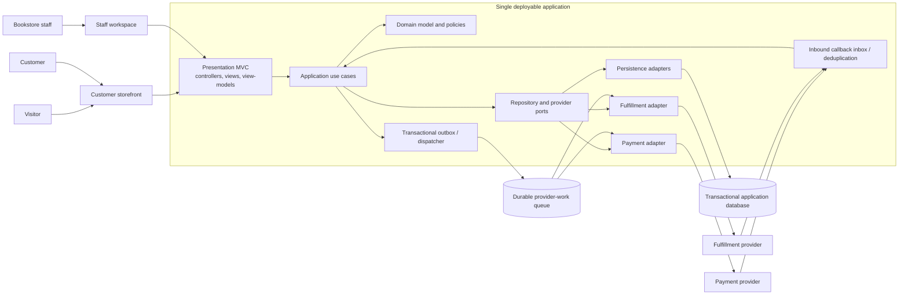

# Online Bookstore Architecture

## 1. Decision

**Selected approach:** A single-deployable **Modular Layered Architecture**
with logical three-tier MVC presentation, application/domain policies, and
data/integration adapters. Use one transaction-capable store for the initial
single-store system.

This is the definitive architecture for the current project. The
event-driven microservices design is retained as an alternative, not the
selected baseline. See [architecture_alternative.md](./architecture_alternative.md)
for that option.

## 2. Rationale and Trade-offs

- One bookstore and one application team do not justify a broker cluster,
  several private databases, distributed saga recovery, and independent
  service deployment overhead.
- A single transactional store can reserve several books atomically and
  commit order, reservation, and local state changes without distributed
  compensation.
- In-process module boundaries preserve modularity and dependency inversion
  without adding network latency to every internal call.
- Payment and fulfillment remain external integrations behind ports. Their
  remote calls do not run inside a database transaction; durable outbox and
  inbox records make retries, callbacks, and reconciliation recoverable.
- The design can evolve toward asynchronous service boundaries if measured
  scaling, team ownership, or availability needs later justify it. Outbox
  event contracts provide an incremental seam, not a commitment to
  microservices.

The trade-off is that the application and primary datastore scale as a unit.
Module boundaries must therefore be enforced in code and tests, and a
datastore outage affects more than one business capability.

## 3. High-Level Pattern and Layers

### 3.1 Presentation tier — MVC

The customer storefront and staff workspace use controllers, views, and
view-models. Controllers authenticate/authorize the request context, validate
request shape, call one application use case, and map results into a response.
Views render data only; they contain no SQL, persistence access, authoritative
price calculation, or business decisions.

### 3.2 Application and domain tier

Application use cases coordinate catalog, account, cart, checkout/order,
inventory, and fulfillment workflows. The domain owns business invariants,
state transitions, totals and order snapshots. Use cases derive customer or
staff identity from trusted authentication context and scope every resource
access accordingly.

Modules have explicit public interfaces. Direct calls between modules are
in-process and use those interfaces; callers do not access another module's
repository or private model. Domain and application policies do not depend on
MVC, the database vendor, or provider SDKs.

### 3.3 Data and integration tier

Persistence adapters implement repository ports using one transactional
store. Payment and fulfillment adapters implement provider ports and translate
provider-specific outcomes into application results. Adapters persist no
business policy and do not decide order or inventory state transitions.

External payment or fulfillment operations use a transactional outbox:
application state and the outbound command/event are committed in the same
local transaction; a dispatcher performs the remote call after commit. Results
and verified callbacks are recorded through an inbox/deduplication boundary.
This pattern addresses process crashes and retries without holding a local
transaction open during a network call.

### 3.4 System context and container/component diagram



The queue is an integration mechanism, not a broker between independently
owned business databases. Domain state remains in the single application
store. In-process notifications may be dispatched from an outbox to a durable
queue; a notification delivery adapter can be added without changing order
ownership.

## 4. Component Boundaries

| Component | Owns | Boundary |
|---|---|---|
| Customer MVC | Storefront pages, request/response view models | Calls use cases; does not query repositories or decide price/stock |
| Staff MVC | Catalog, inventory, and fulfillment screens | Calls authorized staff use cases; UI role hiding is not authorization |
| Account module | Customer profile and account lifecycle | Resolves authenticated customer identity; does not grant staff privileges |
| Catalog module | Book metadata, listing status, categories, current prices | Full-text search, ISBN lookup, and staff updates; does not own reservation counts |
| Cart module | Persistent customer cart and cart lines | Stores displayed prices for reference; checkout revalidates |
| Checkout/Order module | Checkout attempt, order, immutable order-line snapshots, payment/order state | Owns idempotency and order confirmation; coordinates inventory and payment ports |
| Inventory module | On-hand stock, active reservations, adjustments/audit records | Atomically reserves all requested lines or none; validates staff adjustments |
| Fulfillment module | Shipment request and status | Submits confirmed orders and applies correlated provider/staff updates |
| Persistence adapter | Durable representation and repository operations | Implements repository interfaces; no presentation or business policy |
| Payment adapter | Provider authorization/reconciliation protocol | Uses tokenized references; maps provider responses to payment outcomes |
| Fulfillment adapter | Provider shipment protocol | Maps provider updates to shipment status; does not change order ownership |
| Outbox/inbox | Pending outbound work and processed inbound message IDs | Reliable dispatch and duplicate handling; no independent source of domain truth |

### 4.1 Dependency rules

1. Presentation depends on application use-case interfaces.
2. Application depends on domain policies and ports defined at the application
   boundary.
3. Infrastructure adapters implement ports; dependency direction points from
   adapters toward the abstractions, not from domain to vendor code.
4. No view or controller executes SQL or accesses storage directly.
5. No module calls another module's private repository or edits its state
   without its public use-case/domain boundary.

## 5. Cross-Cutting Rules

### 5.1 Checkout idempotency

- Each customer checkout submission has a stable, customer-scoped
  `idempotencyKey` and request fingerprint.
- Repeating the same key and same request returns the current attempt/order
  state and does not create another order or payment attempt.
- Reusing a key with a different request is rejected.
- A new attempt after a completed decline requires an explicit customer retry
  and a new key.
- A uniqueness constraint on the stored customer/key pair enforces the rule
  under concurrent requests.

### 5.2 Inventory consistency

- `available = onHand - reserved`; all three quantities are whole numbers and
  nonnegative, with `reserved <= onHand`.
- Checkout rechecks active listing, current price, and available stock.
- A multi-book reservation is one local transaction: all requested quantities
  are reserved or none are. Concurrent attempts cannot reserve the same unit.
- Staff adjustments record actor, delta, reason, timestamp, and before/after
  values. An adjustment is rejected if the result is negative or below active
  reservations.
- Approved payment consumes the reservation exactly once. A definitive
  decline or verified non-payment outcome releases it exactly once.
- A local timeout does not establish a payment outcome and cannot by itself
  release the reservation.

### 5.3 Payment and order state machines

Payment outcome states are `Pending`, `Approved`, `Declined`, and `Unknown`.
`Unknown` represents a timeout or non-final provider result; it is not a
decline. A payment transition is accepted only when correlated to the stored
attempt and its amount/currency match the order.

```text
Pending -> Approved
Pending -> Declined
Pending -> Unknown
Unknown -> Approved | Declined
Approved -> Voided (only after provider confirms a supported void)
```

The order states are:

```text
PendingPayment -> Confirmed -> FulfillmentInProgress -> Shipped -> Delivered
PendingPayment -> PaymentFailed
PendingPayment -> Cancelled (only after payment is known not captured)
Confirmed -> Cancelled (only when policy allows and required compensation succeeds)
```

An order is confirmed only after verified approval for the matching order
amount and currency. Pending/unknown payment remains unconfirmed and is
reconciled against the original provider attempt. A later approval after a
reservation was safely released requires a provider-supported void/refund
recovery; it must not silently confirm an unfulfillable order.

### 5.4 Provider tokenization and data protection

- The UI obtains or handles only provider-managed/tokenized payment
  references. The application MUST NOT persist raw card numbers or security
  codes.
- Payment credentials and tokens are restricted to the payment boundary;
  persistent order/payment records store provider references and outcome
  metadata only.
- Provider callbacks are authenticated/verified and correlated to the expected
  attempt before applying results. Duplicate or out-of-order messages do not
  regress a final outcome.

### 5.5 Transactional outbox and inbox

The application writes its order/payment/reservation state and the associated
outbound work record in one local database transaction. A dispatcher claims
outbox records, performs remote work outside the transaction, and records
completion/retry state. Inbound callbacks or asynchronous responses are
deduplicated by message/provider event ID in the same transaction that applies
the state change. Delivery is at least once; handlers are idempotent. No
distributed transaction is required.

### 5.6 Authorization and audit

Customer identity is derived from trusted authentication context, never a
caller-supplied owner ID. All customer reads are scoped to that identity.
Staff changes require explicit role authorization at the application boundary.
Inventory changes and order/payment/fulfillment transitions retain actor or
correlation IDs and timestamps for audit.

## 6. Deployment and Scaling

Deploy one web application behind a load balancer with one transactional
database and a durable background dispatcher/worker for provider operations.
The application may run multiple stateless replicas; the shared store
enforces idempotency and inventory concurrency.

Catalog read performance can be improved with indexing and bounded caches.
Checkout writes remain protected by transactional inventory constraints. The
outbox worker can be scaled independently from web request handling while
using claims/leases to prevent competing workers from dispatching the same
work unsafely. External provider calls use bounded concurrency, timeouts,
backoff, and reconciliation.

The project has no defined production throughput, uptime, recovery-time, or
recovery-point targets. Select and validate those before deployment. The
measurable user-task targets are in [requirements.md](./requirements.md).

## 7. Alternative Architecture Assessment

The event-driven microservices proposal offers independent service scaling,
failure isolation, and private data ownership. For this single-store scope, the
review report identifies significant additional broker, outbox/inbox,
distributed-tracing, saga-recovery, and deployment overhead. It also makes
atomic multi-book reservation a distributed consistency problem. The selected
modular design gets a single ACID reservation and simpler debugging while
preserving an outbox boundary for external work.

Reconsider the alternative if measured demand, team boundaries, or independent
availability targets justify the operational cost. The decision should be
reviewed with traffic, failure, and staffing evidence rather than assumed.
