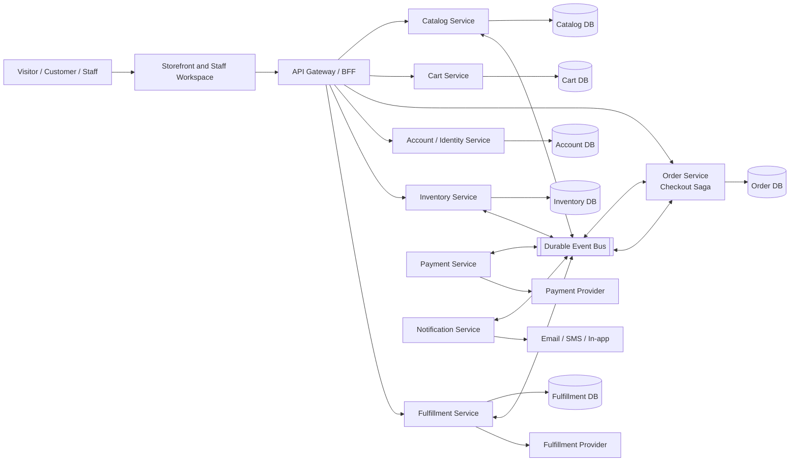
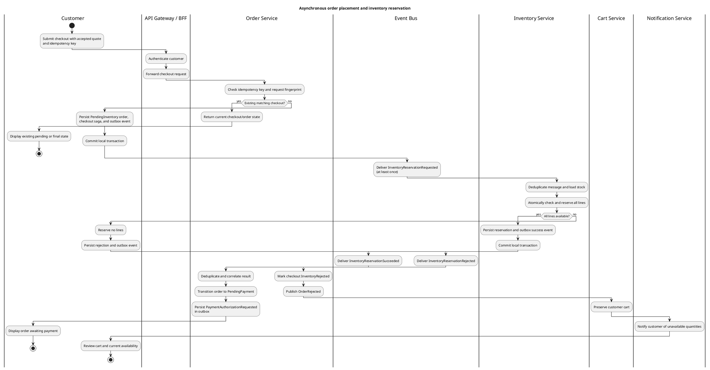
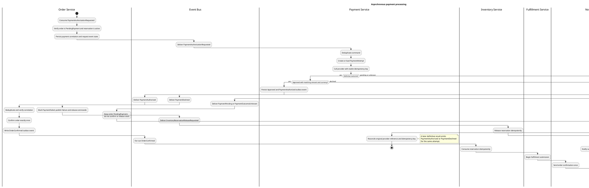
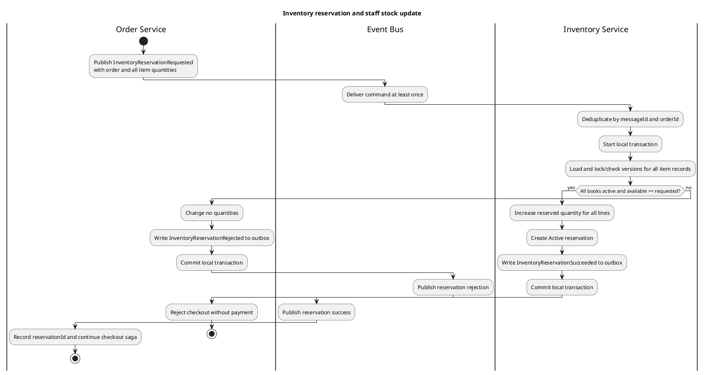
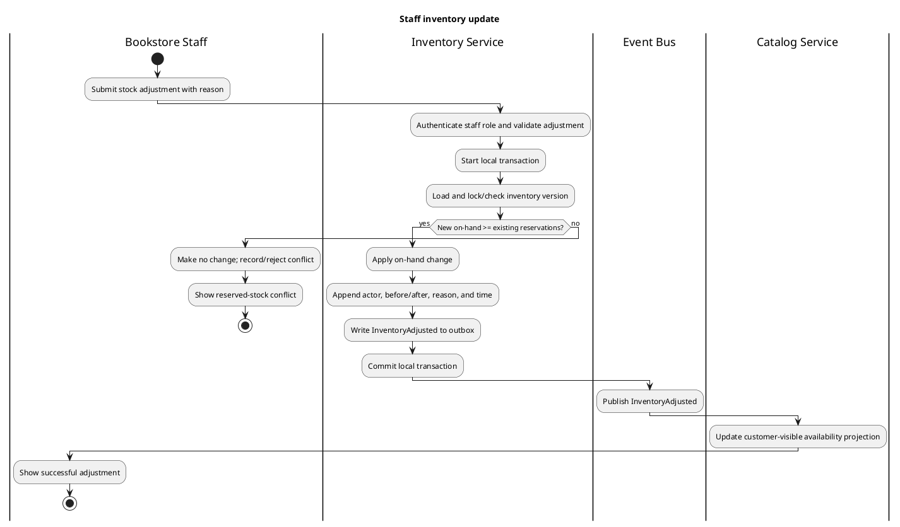
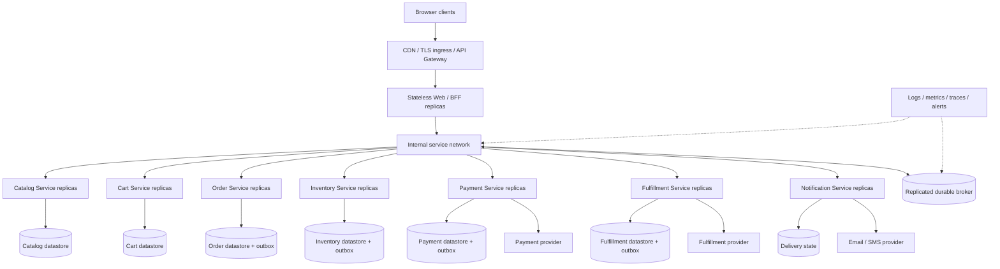

# Online Bookstore Alternative Architecture

## 1. Architectural Overview and Rationale

### 1.1 Proposed architecture

This document defines an alternative to the synchronous, logical three-tier
modular monolith in [architecture_base.md](./architecture_base.md). The
alternative is an **event-driven microservices architecture**: independently
deployable business services own their data and publish versioned domain
events through a durable event bus/message broker. Services react
asynchronously, and an Order Service coordinates checkout as a long-running
saga.

The browser-facing application continues to use MVC or a backend-for-frontend
(BFF). The principal change is behind the presentation boundary: order,
inventory, payment, catalog, fulfillment, and notification responsibilities
are separate services. A service-to-service request that requires an
immediate read may use a narrowly scoped synchronous query; state changes and
cross-service workflow progression use commands and events over the broker.
No service reads another service's database.

### 1.2 Rationale

- **Independent change and scaling**: Catalog reads, checkout orchestration,
  payment work, stock contention, and notification delivery have different
  load and operational characteristics. Separately owned services can be
  scaled and released independently.
- **Asynchronous workflow resilience**: A broker buffers work when a consumer
  or external provider is temporarily unavailable. The Order Service can
  persist a pending order and resume the checkout saga as events arrive rather
  than holding a request or database transaction open across all steps.
- **Clear data ownership**: Each service is authoritative for its business
  state. Explicit events make cross-service state changes observable without
  shared tables or distributed database transactions.
- **Failure isolation**: Notification or fulfillment delays do not need to
  block catalog browsing. Payment uncertainty remains an explicit pending
  state rather than being misreported as a decline or success.

This architecture has higher operational and consistency costs than the base
design. It requires broker operations, message schema/version management,
distributed tracing, idempotent consumers, saga recovery, and eventual
consistency in customer-visible status. Use it when independent deployments,
scaling, or failure isolation justify those costs; the base architecture
remains simpler for a small single-store deployment.

### 1.3 Consistency and delivery guarantees

The broker and services provide **at-least-once delivery**. The design does
not claim end-to-end exactly-once processing. Each consumer deduplicates
messages using `messageId` and records an inbox entry in the same local
transaction as its state change. Each producer writes its state change and an
outbox event in one local transaction; an outbox relay publishes the event
reliably. Duplicate messages and retries are therefore safe.

Events are immutable facts. Commands request work and may be rejected; events
report work that has happened. Eventual consistency is visible to users as
states such as `PendingInventory`, `PendingPayment`, or `Processing`. The
Order Service is the authority for customer-visible order state; Inventory
Service is the authority for stock and reservations; Payment Service is the
authority for payment attempts.

Events carry an envelope with at least:

| Field | Purpose |
|---|---|
| `messageId` | Globally unique delivery/deduplication identifier |
| `eventType`, `schemaVersion` | Event name and compatible payload version |
| `aggregateId`, `aggregateVersion` | Owning entity and per-entity ordering/version |
| `occurredAt` | Event creation time |
| `correlationId` | Checkout/saga correlation |
| `causationId` | Command or prior event that caused this event |
| `producer` | Owning service |

Consumers validate the envelope and schema, tolerate duplicate delivery, and
reject or quarantine unsupported versions. Partition/order messages by
aggregate key where ordering is required; do not assume global ordering.

## 2. Component and Service Breakdown

| Service / component | Data it owns | Responsibilities and boundary |
|---|---|---|
| API Gateway / BFF | No business records | Authenticates or validates the caller context, applies request limits, routes UI requests, and composes presentation responses. It does not own order, payment, or inventory rules. |
| Account / Identity Service | Customer profiles, staff roles, account status | Account lifecycle and identity/role claims. Exposes caller identity to trusted services; does not decide access from a customer-supplied ID. |
| Catalog Service | Book metadata, category, active status, current price | Browse/search, book details, and staff catalog changes. Publishes listing and price changes. Does not own stock quantity. |
| Cart Service | Customer carts and cart lines | Add/change/remove cart items and retain carts after failed checkout. A cart price is only a displayed value, not a purchase guarantee. |
| Order Service | Orders, immutable order-line/price snapshots, checkout attempts, saga state | Accepts idempotent checkout requests, validates the checkout request and price quote, records pending orders, coordinates inventory and payment, applies saga transitions, exposes order history scoped to the customer. |
| Inventory Service | On-hand stock, active reservations, adjustments and audit history | Owns available quantity and performs atomic multi-item reservations, consumption, release, and staff adjustments. Rejects reservations or adjustments that violate stock invariants. |
| Payment Service | Payment attempts and provider references/outcomes | Authorizes and reconciles payment with stable provider idempotency keys; publishes outcomes. Stores token/provider references only, never raw payment credentials. |
| Fulfillment Service | Shipment requests, shipment state and tracking references | Submits confirmed orders to the fulfillment provider, applies verified updates, and publishes fulfillment events. |
| Notification Service | Delivery attempts, preferences, notification references | Sends order/payment/shipment messages from events. Retries independently and deduplicates by event/notification key; never controls order state. |
| Event Bus / Broker | Retained messages, consumer offsets, retry/dead-letter queues | Routes commands and events by topic or equivalent subscription. Provides durable acknowledgement and replay within configured retention. It is not the authoritative store for service entities. |
| External providers | Their own records | Payment authorization and shipment fulfillment. Provider callbacks/events enter through authenticated service adapters and are correlated to a known attempt. |

### 2.1 Ownership and cross-service rules

- Each service has a private datastore and is the sole writer of its owned
  records. Cross-service queries use published read contracts, APIs, or
  consumer-owned projections; shared-database joins are prohibited.
- Catalog and Inventory are separate authorities. Catalog describes the book
  and price; Inventory describes physical stock. An order captures book title,
  unit price, currency, and delivery/total snapshots so later catalog changes
  cannot rewrite an existing order.
- A checkout may query Catalog for current book/price data before accepting a
  quote. It does not query another service's database. Once the customer
  accepts the quote, the Order Service owns the immutable order snapshot.
- Inventory reservation is an atomic operation within Inventory Service. For
  a cart with several books, all requested lines are reserved or none are.
  Reservation responses include a stable reservation reference and expiry
  policy reference, not a promise that can be inferred from a stale catalog
  response.
- Payment is not started until inventory reservation succeeds. An
  `Unknown`/`Pending` payment holds its reservation until reconciliation or a
  verified void/decline; elapsed time alone is not proof that the provider
  rejected payment.
- The Order Service confirms an order only after verified payment approval.
  Fulfillment is triggered only from `OrderConfirmed`.
- Customer reads are scoped using trusted identity claims at every service
  boundary. Staff-only mutations require an explicit staff role. Hiding an ID
  or UI action is not authorization.

### 2.2 Event and command catalog

The names below are logical contracts; they do not prescribe broker syntax.

| Message | Producer → consumer | Meaning |
|---|---|---|
| `CheckoutSubmitted` | Gateway/Order → Order | Idempotent request accepted for validation; includes checkout key and customer context |
| `InventoryReservationRequested` | Order → Inventory | Atomically reserve all order lines |
| `InventoryReservationSucceeded` | Inventory → Order | All lines held under the referenced reservation |
| `InventoryReservationRejected` | Inventory → Order | No lines held; includes unavailable/invalid line reasons |
| `PaymentAuthorizationRequested` | Order → Payment | Authorize exact order total using payment token and stable attempt key |
| `PaymentAuthorized` | Payment → Order | Provider definitively approved matching amount/currency |
| `PaymentDeclined` | Payment → Order | Provider definitively declined |
| `PaymentPending` / `PaymentOutcomeUnknown` | Payment → Order | Outcome unresolved; reconcile original attempt |
| `InventoryReservationReleaseRequested` | Order → Inventory | Release after known decline, cancellation, or safe compensation |
| `InventoryReservationReleased` | Inventory → Order | Reservation released |
| `InventoryReservationConsumed` | Inventory → Order | Approved order's reservation consumed |
| `OrderConfirmed` | Order → Fulfillment, Cart, Notification | Order is confirmed and may proceed to fulfillment |
| `OrderRejected` / `OrderPaymentFailed` | Order → Cart, Notification | Checkout cannot complete; preserve cart and notify |
| `OrderCancelled` | Order → Inventory, Fulfillment, Notification | Cancellation requiring downstream compensation |
| `CatalogBookChanged` / `CatalogPriceChanged` | Catalog → interested consumers | Catalog change for search/read projections; does not rewrite orders |
| `InventoryAdjusted` | Inventory → Catalog, Order, Notification (optional) | Stock change for customer-visible projections |
| `ShipmentSubmissionRequested` | Order → Fulfillment | Request fulfillment after confirmation |
| `ShipmentStatusChanged` | Fulfillment → Order, Notification | Verified shipment progress |

Message payloads MUST avoid unnecessary personal data. Order and provider
references are preferred to copying contact or payment details into every
event. A consumer obtains permitted details through an authenticated contract
when necessary.

## 3. Updated UML Class Diagram Specifications

The UML model shows service interfaces, event contracts, and representative
owned entities. In implementation, classes and data records belong to the
service named in the boundary; the diagram does not imply shared in-memory
objects or shared persistence.

```mermaid
classDiagram
    class CatalogService {
        +searchBooks(criteria) BookSummary[]
        +getBook(bookId) BookDetails
        +changeListing(bookId, details) CatalogBookChanged
        +changePrice(bookId, price) CatalogPriceChanged
    }
    class AccountIdentityService {
        +createAccount(details) Customer
        +authenticate(credentials) IdentityClaims
        +authorizeStaff(identity, action) boolean
    }
    class Customer {
        +customerId
        +email
        +displayName
        +accountStatus
    }
    class StaffUser {
        +staffId
        +email
        +role
        +accountStatus
    }
    class Book {
        +bookId
        +ISBN
        +title
        +authors
        +description
        +category
        +currentPrice
        +currency
        +active
        +activate()
        +deactivate()
        +changePrice(price)
    }
    class CartService {
        +getCart(customerId) Cart
        +addItem(customerId, bookId, quantity)
        +changeQuantity(customerId, bookId, quantity)
        +removeItem(customerId, bookId)
        +preserveAfterFailure(checkoutId)
    }
    class Cart {
        +cartId
        +customerId
        +updatedAt
        +addItem(bookId, quantity)
        +changeQuantity(bookId, quantity)
        +removeItem(bookId)
        +clearAfterConfirmation()
    }
    class CartLine {
        +bookId
        +quantity
        +lastDisplayedUnitPrice
    }
    class OrderService {
        +submitCheckout(request, idempotencyKey)
        +handleInventoryResult(event)
        +handlePaymentResult(event)
        +getCustomerOrders(customerId)
        +startCompensation(reason)
    }
    class CatalogQueryPort {
        <<interface>>
        +getCurrentBooks(bookIds)
        +getCurrentPrices(bookIds)
    }
    class OrderRepository {
        <<interface>>
        +saveOrderAndOutbox(order, event)
        +findByCheckoutKey(customerId, key)
        +load(orderId)
    }
    class InventoryReservationPort {
        <<interface>>
        +requestReservation(orderId, lines, correlationId)
        +requestRelease(reservationId, reason)
        +requestConsumption(reservationId)
    }
    class CheckoutSaga {
        +checkoutId
        +idempotencyKey
        +state
        +correlationId
        +start()
        +onInventoryReserved(event)
        +onInventoryRejected(event)
        +onPaymentResult(event)
        +onTimeout()
    }
    class Order {
        +orderId
        +customerId
        +checkoutId
        +orderReference
        +orderState
        +currency
        +grandTotal
        +createdAt
        +confirm(paymentReference)
        +failPayment(reason)
        +cancel(reason)
    }
    class OrderLine {
        +bookId
        +titleSnapshot
        +quantity
        +unitPriceSnapshot
        +lineTotal
    }
    class InventoryService {
        +reserveAll(orderId, lines, correlationId)
        +release(reservationId, reason)
        +consume(reservationId)
        +adjustStock(staffId, bookId, delta, reason)
    }
    class InventoryItem {
        +bookId
        +onHand
        +reserved
        +version
        +available()
        +reserve(quantity)
        +release(quantity)
        +consume(quantity)
        +adjustOnHand(delta)
    }
    class InventoryReservation {
        +reservationId
        +orderId
        +state
        +expiresAt
        +consume()
        +release()
    }
    class PaymentService {
        +authorize(request, idempotencyKey)
        +reconcile(paymentAttemptId)
        +handleProviderEvent(event)
    }
    class PaymentAttempt {
        +paymentAttemptId
        +orderId
        +providerReference
        +amount
        +currency
        +state
        +recordOutcome(outcome)
        +markUnknown()
        +reconcile(outcome)
    }
    class EventBus {
        <<interface>>
        +publish(event)
        +subscribe(eventType, handler)
        +ack(messageId)
        +retry(messageId)
    }
    class Outbox {
        <<interface>>
        +append(event)
        +readUnpublished(batchSize)
        +markPublished(eventId)
    }
    class PaymentProviderPort {
        <<interface>>
        +authorize(request, idempotencyKey)
        +lookup(providerReference)
        +void(providerReference)
    }
    class FulfillmentService {
        +submitConfirmedOrder(orderReference, lines, address)
        +handleProviderUpdate(event)
        +getShipmentStatus(orderId)
    }
    class FulfillmentProviderPort {
        <<interface>>
        +submitShipment(request, idempotencyKey)
        +lookupShipment(providerReference)
    }
    class Shipment {
        +shipmentId
        +orderId
        +providerReference
        +status
        +trackingDetails
        +applyUpdate(update)
    }
    class DomainEvent {
        <<interface>>
        +messageId
        +eventType
        +schemaVersion
        +aggregateId
        +aggregateVersion
        +correlationId
        +causationId
        +occurredAt
    }
    class InventoryReservationRequested {
        +orderId
        +lines
    }
    class InventoryReservationSucceeded {
        +orderId
        +reservationId
        +reservedLines
    }
    class PaymentAuthorizationRequested {
        +orderId
        +paymentAttemptId
        +amount
        +currency
        +paymentToken
        +idempotencyKey
    }
    class PaymentAuthorized {
        +orderId
        +paymentAttemptId
        +providerReference
        +amount
        +currency
    }
    class PaymentDeclined {
        +orderId
        +paymentAttemptId
        +reasonCode
    }
    class OrderConfirmed {
        +orderId
        +orderReference
        +customerId
        +confirmedAt
    }
    class ShipmentStatusChanged {
        +orderId
        +shipmentId
        +eventReference
        +status
        +occurredAt
    }
    class PaymentOutcomeUnknown {
        +orderId
        +paymentAttemptId
        +providerReference
    }
    class InventoryReservationRejected {
        +orderId
        +unavailableLines
    }
    class InventoryReservationReleaseRequested {
        +orderId
        +reservationId
        +reason
    }
    class NotificationService {
        +onOrderEvent(event)
        +onPaymentEvent(event)
        +onShipmentEvent(event)
        +sendOnce(notificationKey, message)
    }

    CatalogService --> Book : owns
    AccountIdentityService --> Customer : owns
    AccountIdentityService --> StaffUser : owns
    CartService --> Cart : owns
    Customer "1" --> "0..1" Cart : owns
    Cart "1" *-- "0..*" CartLine : contains
    CartLine "*" --> "1" Book : references
    OrderService --> CheckoutSaga : coordinates
    OrderService --> Order : owns
    Customer "1" --> "0..*" Order : places
    OrderService --> CatalogQueryPort : obtains current quote
    OrderService --> OrderRepository : persists order and outbox
    OrderService --> InventoryReservationPort : requests stock actions
    Order "1" *-- "1..*" OrderLine : contains
    FulfillmentService --> Shipment : owns
    Shipment "*" --> "1" Order : fulfills
    FulfillmentService --> FulfillmentProviderPort : uses
    CheckoutSaga --> InventoryReservationRequested : publishes
    CheckoutSaga --> PaymentAuthorizationRequested : publishes
    InventoryService --> InventoryItem : owns
    InventoryService --> InventoryReservation : owns
    InventoryReservation "*" --> "1..*" InventoryItem : holds
    PaymentService --> PaymentAttempt : owns
    PaymentService --> PaymentProviderPort : uses
    EventBus --> DomainEvent : transports
    Outbox --> DomainEvent : persists
    InventoryReservationRequested --|> DomainEvent
    InventoryReservationSucceeded --|> DomainEvent
    PaymentAuthorizationRequested --|> DomainEvent
    PaymentAuthorized --|> DomainEvent
    PaymentDeclined --|> DomainEvent
    OrderConfirmed --|> DomainEvent
    ShipmentStatusChanged --|> DomainEvent
    PaymentOutcomeUnknown --|> DomainEvent
    InventoryReservationRejected --|> DomainEvent
    InventoryReservationReleaseRequested --|> DomainEvent
    NotificationService --> DomainEvent : consumes
    FulfillmentService ..> OrderConfirmed : consumes
    FulfillmentService ..> ShipmentStatusChanged : publishes
```

### 3.1 Entity ownership and invariants

- **Book** belongs to Catalog Service. `bookId` is stable; ISBN may be
  absent. Price changes create events but never mutate an order-line snapshot.
- **Cart / CartLine** belong to Cart Service. Cart prices are advisory.
  Customer identity comes from a trusted request context.
- **CheckoutSaga** and **Order / OrderLine** belong to Order Service. A unique
  customer-scoped idempotency key maps repeated submissions to the same
  checkout. The order snapshot includes item titles/prices, currency, totals,
  and delivery details needed to fulfill the accepted purchase.
- **InventoryItem** belongs to Inventory Service. `available = onHand -
  reserved` MUST remain nonnegative. Reservation of all order lines succeeds
  atomically or none are reserved. Staff adjustments cannot reduce on-hand
  below reserved quantities.
- **InventoryReservation** has terminal outcomes `Consumed` or `Released`;
  either action is idempotent. Expiry MUST NOT release a hold while payment
  outcome is unresolved.
- **PaymentAttempt** belongs to Payment Service. `Pending` or `Unknown` does
  not confirm an order. Retries use the same provider idempotency key and
  reconcile the original provider reference.
- **DomainEvent** is an immutable integration contract, not a shared entity.
  Schema evolution is additive when possible; incompatible changes require a
  new version and consumer migration plan.

## 4. Activity Diagram Workflows

### 4.1 Asynchronous order placement and inventory reservation

The order is durably accepted as `PendingInventory` before the reservation
command is published. Inventory processing and the result are asynchronous.
Payment cannot start until the Order Service consumes a successful reservation
event.

If delivery is repeated, Inventory deduplicates the request and returns the
existing reservation outcome. The Order Service deduplicates the result. A
timeout while awaiting the result leaves the order pending and triggers
redelivery or status reconciliation; it does not create a second order.

### 4.2 Asynchronous payment processing

Payment Service consumes the persisted authorization command and calls the
provider outside a local database transaction. Its result is committed with
an outbox event. Provider callbacks or reconciliation can complete an
indeterminate attempt later.

If approval arrives after the business has determined that the reservation
cannot remain valid, the Order Service MUST NOT confirm an unfulfillable order.
It initiates a provider-supported void/refund compensation and alerts
operations. Do not infer a decline from elapsed time alone.

### 4.3 Inventory reservation

Both checkout reservations and staff changes are serialized by the Inventory
Service against its own stock records. The multi-line reservation is atomic
within that service; no distributed transaction spans the broker and data
store.

### 4.4 Staff inventory update

Both flows operate on the same Inventory Service ownership boundary and stock
invariant. A version conflict is retried only a bounded number of times;
exhausted retries return a conflict rather than silently accepting an
inconsistent quantity.

## 5. Deployment and Scalability Considerations

### 5.1 Logical deployment

The diagram is a logical deployment target, not a cloud/provider selection.
Container orchestration or managed services may be selected later. Services
may initially share a cluster, but retain separate deployment units,
identities, schemas, and datastore ownership.

### 5.2 Scaling strategy

- Scale stateless API/service replicas horizontally. Scale broker consumers
  independently according to queue lag and processing time.
- Partition high-volume topics by `aggregateId` or another domain key to keep
  per-order or per-book event ordering where required. A hot inventory item
  may remain a serialization bottleneck by design; optimize only after
  measurement without weakening no-oversell guarantees.
- Scale Catalog read/search independently using service-owned read indexes or
  projections. Treat projections as rebuildable and eventually consistent.
- Isolate slow notification delivery from checkout with separate queues and
  retry policies. Do not let a notification outage block order confirmation.
- Apply backpressure and bounded concurrency when calling payment and
  fulfillment providers; respect provider quotas and timeout budgets.
- Keep order and inventory write paths strongly consistent within each
  owning service. Use events and projections only for cross-service read
  models, not as a substitute for an atomic inventory reservation.

### 5.3 Reliability and operations

- Use transactional outbox/inbox patterns for state-plus-message atomicity;
  configure retries with backoff and jitter, bounded retry counts, and
  dead-letter queues with ownership and replay procedures.
- Make replay safe through idempotent consumers and immutable, versioned event
  contracts. Keep sensitive payment and personal data out of broadly
  distributed messages.
- Propagate `correlationId`, `causationId`, order ID, and message ID through
  logs and traces. Monitor queue depth/age, consumer lag, outbox age, payment
  pending duration, reservation age, duplicate rate, dead letters, and saga
  completion/failure rates.
- Define operational recovery for stuck sagas, provider timeouts, dead-letter
  replay, broker unavailability, and late payment approval. Recovery actions
  must be audited and safe to repeat.
- Back up each service's datastore and document restore/replay order. Rebuild
  projections from retained events or authoritative service APIs; do not
  treat an event projection as the only copy of business state.
- Protect service-to-service communication with authenticated identities and
  least-privilege permissions. Verify provider callbacks before publishing
  internal events; apply rate limits and data minimization at ingress.

### 5.4 Consistency, security, and service-level decisions

- **No global transaction**: Checkout is a saga with explicit pending states
  and compensating actions. A confirmed order, payment, and inventory
  reservation are correlated but reside in different service stores.
- **Reservation lifecycle**: Reservations have a bounded policy, but expiration
  must coordinate with payment reconciliation. Release only after a verified
  non-payment outcome or completed compensation. A local timeout alone must
  not release stock if the provider may have approved payment.
- **Payment protection**: Persist provider references/tokenized instruments
  only. Keep payment provider credentials in a secret manager, rotate them,
  and restrict access to Payment Service.
- **Availability goals**: The base specification defines user-task measures
  but no service uptime, recovery-time, recovery-point, event-retention, or
  throughput SLO. Those numbers must be selected before production deployment;
  do not infer targets from this design.
- **Failure behavior**: Catalog browsing may continue during downstream
  notification outages. Checkout may accept a pending order while broker
  delivery catches up only if the local outbox has durably recorded the
  message. If order persistence or durable enqueue fails, report failure and
  do not claim checkout acceptance.

## Trade-offs and Adoption Criteria

Adopt this alternative when independent deployment, service-specific
scaling, organizational ownership, or resilience from isolated failures are
important enough to justify broker infrastructure and distributed-systems
operations. Prefer the
[base architecture](./specs/001-online-bookstore/architecture.md) for a
small coursework implementation or single-team storefront when simplicity,
local transactions, and fast implementation matter more. Both architectures
preserve the same business requirements; this document changes how those
requirements are partitioned and coordinated, not their customer-visible
meaning.
