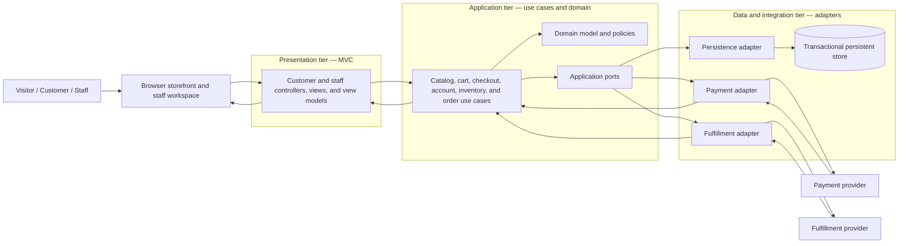
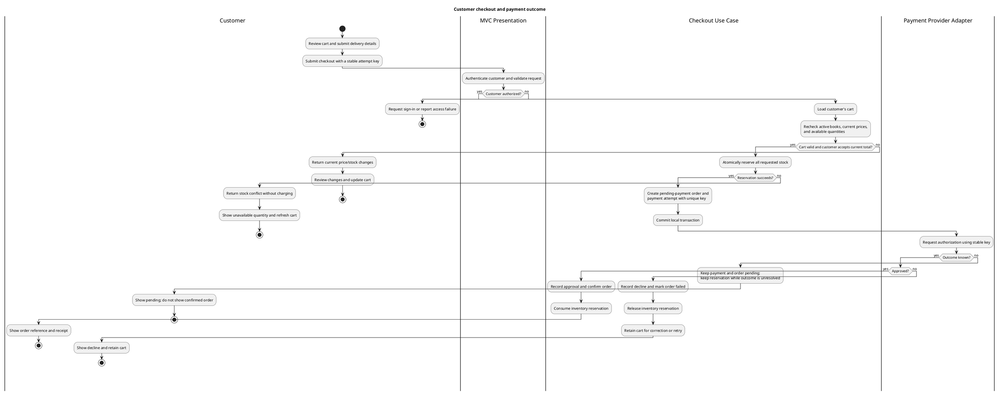
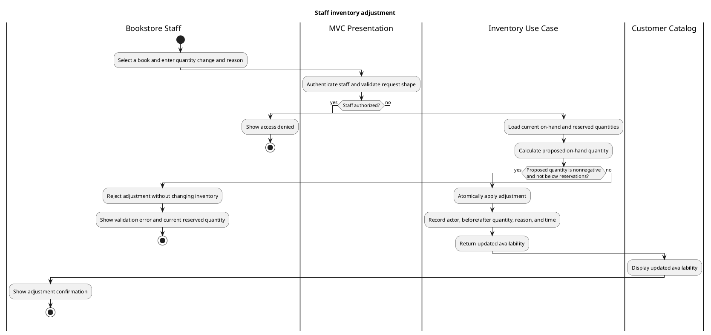

# Online Bookstore Base Architecture

## Architectural Decision

Use a logical three-tier architecture for a browser-based bookstore:

1. **Presentation tier — MVC**: customer storefront and staff workspace.
   Controllers handle requests, establish the caller's identity, validate
   request shape, and present use-case results through views. Views contain no
   business rules and do not access storage.
2. **Application tier — use cases and domain**: orchestrates catalog, cart,
   account, checkout, order, inventory, and fulfillment workflows. Domain
   objects enforce business invariants. Application ports describe required
   persistence and provider capabilities.
3. **Data and integration tier — adapters**: implements application ports for
   persistent storage, payment authorization, and fulfillment. Adapters
   translate external results into application outcomes; they do not own
   bookstore policies.

The application tier contains distinct application and domain layers. The
three tiers are logical responsibility and dependency boundaries, not a
requirement for separate deployables. Begin with one cohesive application
because the scope is one bookstore and there is no evidence for the operational
cost of distributed services. Modules communicate through narrow interfaces;
dependencies point inward toward the domain and application policies.

## Component Boundaries

| Component | Owns | Must not |
|---|---|---|
| Customer MVC | Catalog pages, cart and checkout interactions, account and order views | Calculate authoritative prices, authorize purchases, or query storage directly |
| Staff MVC | Staff catalog, inventory, and order-management interactions | Bypass staff authorization or directly change domain records |
| Identity and access boundary | Establish caller identity and staff/customer roles; enforce resource ownership | Treat a customer-supplied identifier as proof of ownership |
| Catalog use cases | Search and retrieve active books and availability | Own stock reservation or provider-specific behavior |
| Cart use cases | Add, change, remove, and summarize cart lines | Treat a cart's saved price or stock as a checkout guarantee |
| Checkout use case | Revalidate a cart, calculate the payable quote, reserve stock, coordinate payment, and transition order state | Hold a storage transaction open during a remote payment call |
| Account and order use cases | Create accounts, return a customer's own order history and details | Expose another customer's account or order |
| Catalog and inventory use cases | Maintain listings, post stock adjustments, and record reservations and releases | Allow available stock to become negative or staff changes to consume reserved units |
| Fulfillment use case | Submit eligible orders and apply provider/staff shipment progress | Confirm payment or rewrite purchased item prices |
| Domain | Customer, Book, Cart, Inventory, Reservation, Order, PaymentAttempt, and Shipment invariants | Depend on MVC, a storage product, or provider SDKs |
| Persistence adapter | Store and retrieve domain state; enforce atomic conditional updates and uniqueness | Implement presentation behavior or make external provider calls |
| Payment adapter | Authorize and reconcile payments through the selected provider | Decide when the bookstore order is considered confirmed |
| Fulfillment adapter | Submit fulfillment details and normalize shipment updates | Change order ownership, payment outcomes, or inventory policy |

### Dependency and Request Flow

The diagram shows logical ownership and call directions, not a deployment
topology. Provider callbacks, if supported by the selected provider, enter
through the corresponding adapter and are verified before the application
applies an outcome.

## Cross-Cutting Rules

- **Authorization**: customer use cases derive the customer identity from the
  authenticated context and scope every account/order lookup to that identity.
  Staff mutations require an authorized staff role. Controllers provide an
  early access check; the application boundary remains authoritative.
- **Money and totals**: use a consistent currency and exact monetary
  representation. The checkout use case calculates the authoritative item
  totals, taxes, and delivery charges and returns the complete quote before
  payment.
- **Inventory concurrency**: available quantity is on-hand quantity minus
  quantity reserved for unsettled checkouts. Reserve requested quantities
  atomically at checkout. An inventory adjustment cannot reduce on-hand below
  active reservations. Confirmed purchase consumes the reservation; a known
  decline or safe cancellation releases it.
- **Payment uncertainty**: a timeout is not a decline. Preserve an explicit
  pending/unknown payment attempt and do not confirm the order. Reconcile with
  the provider using the same stable idempotency key before retrying or
  releasing its stock reservation.
- **Duplicate checkout**: every checkout attempt has a stable unique key. A
  repeated request with the same key returns the existing attempt/order and
  cannot create another payment or confirmed order.
- **Data minimization**: the application stores provider references and
  tokenized payment references only; raw payment credentials are not persisted.
- **Auditability**: record who made a staff stock adjustment, its quantity
  change, reason, and time. Record order/payment/fulfillment state transitions
  with their correlation references.
- **Provider isolation**: provider-specific identifiers and messages are
  translated at adapters; domain and presentation contracts use bookstore
  terms and outcomes.

## Checkout Activity Diagram

An unresolved payment is reconciled through the payment contract using the
original attempt key. A reservation is released only after a decline, void, or
other verified outcome that guarantees the payment cannot later be captured.
Recovery and any reservation expiration policy must preserve this guarantee.

## Staff Inventory-Update Activity Diagram

## Decisions Deferred to Implementation

The repository does not select a language, framework, storage engine, hosting
topology, identity provider, payment provider, fulfillment provider, tax
service, or currency. Choose those in implementation planning while preserving
the responsibility boundaries and invariants above. Numeric reservation
lifetimes and provider-specific reconciliation schedules also require a
provider and operational policy; do not guess them in the domain contract.
