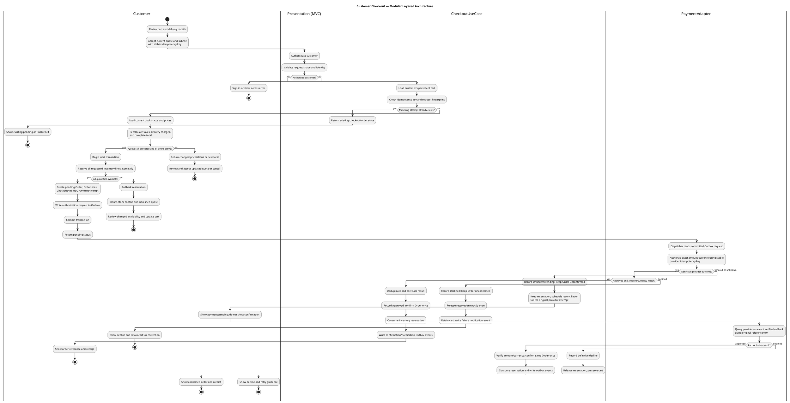
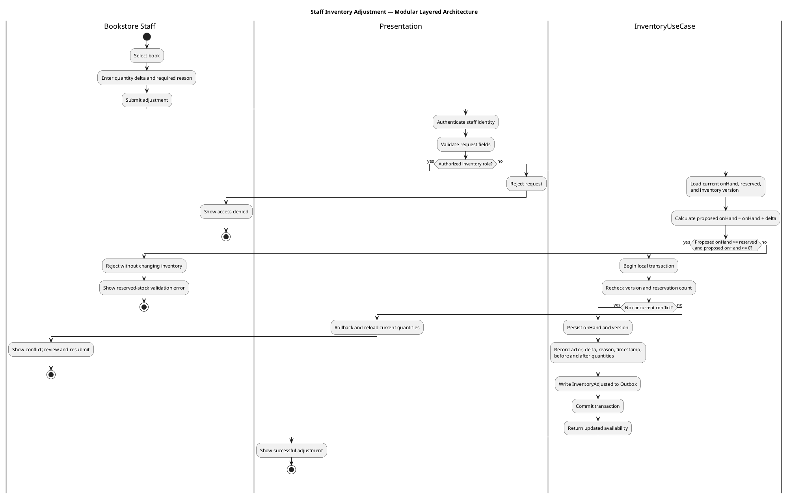

# Online Bookstore Detailed Design

## 1. Design Scope

This document gives the low-level, technology-neutral object model and
workflows for the selected modular layered architecture in
[architecture.md](./architecture.md). Domain behavior is separated from MVC,
storage, and provider details. The classes are logical design responsibilities;
they do not require a particular programming language or ORM.

## 2. Domain Entities and State

| Entity | Owns / validates |
|---|---|
| `Customer` | Account identity, email/contact details, account status; order/cart ownership is verified against trusted identity |
| `Book` | ISBN (optional), title, author(s), description, category, current price/currency, active status |
| `Cart` / `CartLine` | Persistent customer selection and positive integer quantity; displayed price is advisory |
| `Order` / `OrderLine` | Customer, reference/date, delivery snapshot, totals, status; purchased title, quantity, unit price, currency, and line total are immutable snapshots |
| `InventoryItem` | `onHand`, `reserved`, version; available quantity is derived as `onHand - reserved` |
| `InventoryReservation` | Order-scoped held stock; transitions once from `Active` to `Consumed` or `Released` |
| `InventoryAdjustment` | Staff identity, delta, reason, time, before/after values |
| `CheckoutAttempt` | Customer-scoped idempotency key, request fingerprint, status, order association |
| `PaymentAttempt` | Provider reference, amount/currency, token reference, idempotency key, outcome and timestamps |
| `Shipment` | Order association, provider reference, latest fulfillment status, tracking information |
| `OutboxMessage` / `InboxMessage` | Durable pending external work and deduplicated inbound message/event IDs |

### 2.1 Validation and state rules

- Cart line quantities and inventory quantities are positive/nonnegative whole
  values. `reserved <= onHand`; `available = onHand - reserved`.
- Multi-item reservations either update every inventory line or update none.
  Reservation consumption/release and duplicate checkout handling are
  idempotent.
- Reusing an idempotency key with a different request fingerprint is rejected.
- Payment outcomes are `Pending`, `Approved`, `Declined`, or `Unknown`.
  `Unknown` is not a decline or approval and requires reconciliation of the
  original attempt.
- Orders are not `Confirmed` until payment is definitively approved for the
  exact order amount/currency. Purchased order-line values cannot change after
  confirmation.
- Inventory adjustments cannot lower on-hand below active reservations and
  must retain the staff actor, delta, reason, timestamp, and before/after
  values.
- A shipment is created/updated only for a valid order and duplicate provider
  events cannot regress a final state.

## 3. UML Class Diagram

The diagram distinguishes composition (`*--`) for lifecycle-owned parts,
aggregation (`o--`) for separately managed inventory referenced by a book,
associations (`-->`) for business links, and interface realization (`..|>`)
for adapters and use-case implementations.

```plantuml
@startuml
title Online Bookstore — Modular Layered Class Design
skinparam packageStyle rectangle
hide empty members

package "Presentation (MVC)" {
  class CustomerController {
    +browse(criteria)
    +updateCart(command)
    +submitCheckout(command)
    +viewOrders()
  }
  class StaffController {
    +updateBook(command)
    +adjustInventory(command)
    +updateFulfillment(command)
  }
  class BookViewModel {
    +bookId
    +title
    +price
    +availability
  }
  class CheckoutViewModel {
    +quote
    +orderReference
    +status
  }
}

package "Application Services and Ports" {
  interface CatalogUseCase {
    +search(criteria)
    +getDetails(bookId)
    +updateListing(command)
  }
  class CatalogService

  interface CheckoutUseCase {
    +quote(customerId, cartId)
    +submit(customerId, command, idempotencyKey)
    +reconcile(paymentAttemptId)
  }
  class CheckoutService

  interface InventoryUseCase {
    +reserveAll(orderId, lines)
    +release(reservationId, reason)
    +consume(reservationId)
    +adjustOnHand(staffId, bookId, delta, reason)
  }
  class InventoryService

  interface InventoryReservationPort {
    +reserveAll(orderId, lines)
    +release(reservationId, reason)
    +consume(reservationId)
  }

  interface OrderQueryUseCase {
    +getCustomerOrders(customerId)
    +getOrder(customerId, orderId)
    +recordFulfillment(orderId, update)
  }
  class OrderService

  interface FulfillmentUseCase {
    +submitConfirmedOrder(orderId)
    +applyProviderUpdate(update)
  }
  class FulfillmentService

  interface CatalogQueryPort {
    +getCurrentBooks(bookIds)
    +getCurrentPrices(bookIds)
  }
  interface CustomerRepository {
    +findById(customerId)
    +save(customer)
  }
  interface CatalogRepository {
    +findActive(criteria)
    +findByIds(bookIds)
    +save(book)
  }
  interface CartRepository {
    +findForCustomer(customerId)
    +save(cart)
  }
  interface OrderRepository {
    +findByCheckoutKey(customerId, key)
    +saveOrderAndOutbox(order, message)
    +findForCustomer(customerId, orderId)
  }
  interface InventoryRepository {
    +loadItemsForUpdate(bookIds)
    +saveReservation(reservation)
    +saveAdjustment(adjustment)
  }
  interface PaymentProviderPort {
    +authorize(request, idempotencyKey)
    +lookup(providerReference)
    +void(providerReference)
  }
  interface FulfillmentProviderPort {
    +submitShipment(request, idempotencyKey)
    +lookupShipment(providerReference)
  }
  interface NotificationPort {
    +send(message, idempotencyKey)
  }
  interface OutboxRepository {
    +append(message)
    +claimPending(batchSize)
    +markDispatched(messageId)
  }
  interface InboxRepository {
    +recordIfNew(messageId)
  }
}

package "Domain Model" {
  class Customer {
    +customerId
    +email
    +displayName
    +accountStatus
    +updateContact(details)
    +ownsOrder(orderId)
  }
  class StaffUser {
    +staffId
    +email
    +role
    +accountStatus
    +canAdjustInventory()
  }
  class Book {
    +bookId
    +ISBN
    +title
    +authors
    +description
    +category
    +currentPrice
    +currency
    +active
    +changePrice(price)
    +activate()
    +deactivate()
  }
  class Cart {
    +cartId
    +customerId
    +updatedAt
    +addItem(bookId, quantity)
    +changeQuantity(bookId, quantity)
    +removeItem(bookId)
    +clearOrderedLines(orderId)
  }
  class CartLine {
    +bookId
    +quantity
    +lastDisplayedUnitPrice
  }
  class CheckoutAttempt {
    +checkoutAttemptId
    +customerId
    +idempotencyKey
    +requestFingerprint
    +state
    +begin()
    +complete(result)
  }
  class Order {
    +orderId
    +orderReference
    +customerId
    +checkoutAttemptId
    +createdAt
    +currency
    +itemSubtotal
    +taxTotal
    +deliveryTotal
    +grandTotal
    +deliveryAddressSnapshot
    +state
    +confirm(paymentAttempt)
    +failPayment(reason)
    +recordFulfillment(status)
    +cancel(reason)
  }
  class OrderLine {
    +bookId
    +titleSnapshot
    +quantity
    +unitPriceAtPurchase
    +lineTotal
  }
  class InventoryItem {
    +bookId
    +onHand
    +reserved
    +version
    +available()
    +reserve(quantity)
    +release(quantity)
    +consume(quantity)
    +adjustOnHand(delta)
  }
  class InventoryReservation {
    +reservationId
    +orderId
    +state
    +createdAt
    +resolvedAt
    +consume()
    +release()
  }
  class InventoryAdjustment {
    +adjustmentId
    +staffId
    +bookId
    +delta
    +reason
    +occurredAt
    +beforeQuantity
    +afterQuantity
  }
  class PaymentAttempt {
    +paymentAttemptId
    +orderId
    +providerReference
    +tokenReference
    +idempotencyKey
    +amount
    +currency
    +state
    +recordOutcome(outcome)
    +markUnknown()
    +reconcile(outcome)
  }
  class Shipment {
    +shipmentId
    +orderId
    +providerReference
    +state
    +trackingDetails
    +lastUpdatedAt
    +applyUpdate(update)
  }
  class OutboxMessage {
    +messageId
    +eventType
    +schemaVersion
    +aggregateId
    +correlationId
    +causationId
    +occurredAt
    +status
  }
  class InboxMessage {
    +messageId
    +consumer
    +receivedAt
  }
  class PaymentOutcome {
    <<enumeration>>
    Pending
    Approved
    Declined
    Unknown
  }
  class OrderState {
    <<enumeration>>
    PendingPayment
    Confirmed
    PaymentFailed
    FulfillmentInProgress
    Shipped
    Delivered
    Cancelled
  }
  class ReservationState {
    <<enumeration>>
    Active
    Consumed
    Released
  }
}

package "Adapters" {
  class CatalogQueryAdapter
  class CustomerRepositoryAdapter
  class CatalogRepositoryAdapter
  class CartRepositoryAdapter
  class OrderRepositoryAdapter
  class InventoryRepositoryAdapter
  class PaymentAdapter
  class FulfillmentAdapter
  class NotificationAdapter
  class OutboxInboxAdapter
  class OutboxDispatcher {
    +dispatchPending()
  }
}

CustomerController --> CatalogUseCase : invokes
CustomerController --> CheckoutUseCase : invokes
StaffController --> CatalogUseCase : invokes
StaffController --> InventoryUseCase : invokes
StaffController --> OrderQueryUseCase : invokes
CatalogService ..|> CatalogUseCase
CheckoutService ..|> CheckoutUseCase
InventoryService ..|> InventoryUseCase
InventoryService ..|> InventoryReservationPort
OrderService ..|> OrderQueryUseCase
FulfillmentService ..|> FulfillmentUseCase

CatalogService --> CatalogRepository : uses
CheckoutService --> CartRepository : uses
CheckoutService --> OrderRepository : uses
CheckoutService --> CatalogQueryPort : revalidates quote
CheckoutService --> InventoryReservationPort : reserves stock
CheckoutService --> OutboxRepository : schedules payment
InventoryService --> InventoryRepository : uses
OrderService --> OrderRepository : uses
OrderService --> FulfillmentUseCase : starts after confirmation
FulfillmentService --> FulfillmentProviderPort : submits shipment
FulfillmentService --> OrderQueryUseCase : records status
OrderService --> NotificationPort : schedules notices
PaymentAdapter ..|> PaymentProviderPort
FulfillmentAdapter ..|> FulfillmentProviderPort
NotificationAdapter ..|> NotificationPort
CatalogQueryAdapter ..|> CatalogQueryPort
CustomerRepositoryAdapter ..|> CustomerRepository
CatalogRepositoryAdapter ..|> CatalogRepository
CartRepositoryAdapter ..|> CartRepository
OrderRepositoryAdapter ..|> OrderRepository
InventoryRepositoryAdapter ..|> InventoryRepository
OutboxInboxAdapter ..|> OutboxRepository
OutboxInboxAdapter ..|> InboxRepository
OutboxDispatcher --> OutboxRepository : claims messages
OutboxDispatcher --> PaymentProviderPort : dispatches authorization
OutboxDispatcher --> InboxRepository : deduplicates results

Customer "1" --> "0..1" Cart : owns
Cart "1" *-- "0..*" CartLine : contains
CartLine "*" --> "1" Book : selects
Book "1" o-- "1" InventoryItem : availability record
Customer "1" --> "0..*" CheckoutAttempt : submits
CheckoutAttempt "1" --> "0..1" Order : creates
Customer "1" --> "0..*" Order : places
Order "1" *-- "1..*" OrderLine : contains
Order "1" *-- "1..*" PaymentAttempt : records
Order "1" *-- "0..*" InventoryReservation : reserves
InventoryReservation "*" --> "1..*" InventoryItem : holds
StaffUser "1" --> "0..*" InventoryAdjustment : performs
InventoryAdjustment "*" --> "1" InventoryItem : adjusts
Order "1" o-- "0..1" Shipment : fulfillment status
PaymentAttempt --> PaymentOutcome : state
Order --> OrderState : state
InventoryReservation --> ReservationState : state
Order "1" --> "0..*" OutboxMessage : emits
InboxMessage ..> OutboxMessage : deduplicates by message ID
@enduml
```

### 3.1 UML relationship notes

- `Cart` and `Order` compose their lines: lines have no independent lifecycle
  after their owner is removed (order lines are retained with the order).
- `Order` composes payment attempts and reservations as order-owned history.
- `Book` aggregates the separately maintained `InventoryItem`; inventory is
  not part of the book metadata lifecycle.
- `Shipment` is aggregated by `Order` because provider shipment identity and
  status may be retained independently for audit/reconciliation.
- `..|>` denotes an adapter or service implementation realizing an interface.
- `OrderLine` stores snapshots and does not depend on mutable `Book` values for
  historical display or totals.

## 4. Activity Diagram — Customer Checkout

The checkout workflow revalidates price and stock, reserves all lines
atomically, then requests payment through the outbox dispatcher. Payment
provider calls occur outside local database transactions. A pending/unknown
outcome remains unresolved until reconciliation of the same provider attempt.

If reconciliation cannot establish a final result, the payment stays
`Unknown`/`Pending`; the workflow repeats reconciliation without creating a
second order or payment attempt. Reservation expiry MUST not release stock
until policy establishes that payment cannot later be captured.

## 5. Activity Diagram — Staff Inventory Adjustment

The use case applies an adjustment under the same inventory transaction and
invariant used by checkout reservations. A rejected adjustment changes
nothing.

## 6. Outbox Event Envelope

External work is serialized as a versioned message stored in the same local
transaction as its state change:

| Field | Description |
|---|---|
| `messageId` | Unique identifier used for deduplication |
| `eventType`, `schemaVersion` | Stable event name and contract version |
| `aggregateId`, `aggregateVersion` | Order, inventory item, or payment attempt and version |
| `occurredAt` | Event creation timestamp |
| `correlationId` | Checkout/order workflow correlation |
| `causationId` | Command or prior event that caused this message |
| `payload` | Minimum necessary domain facts; excludes raw payment credentials |

The dispatcher may deliver a message more than once. The receiver records the
message ID in an inbox and applies state changes idempotently. Schema changes
are additive when possible; incompatible changes use a new version with a
consumer migration plan.
