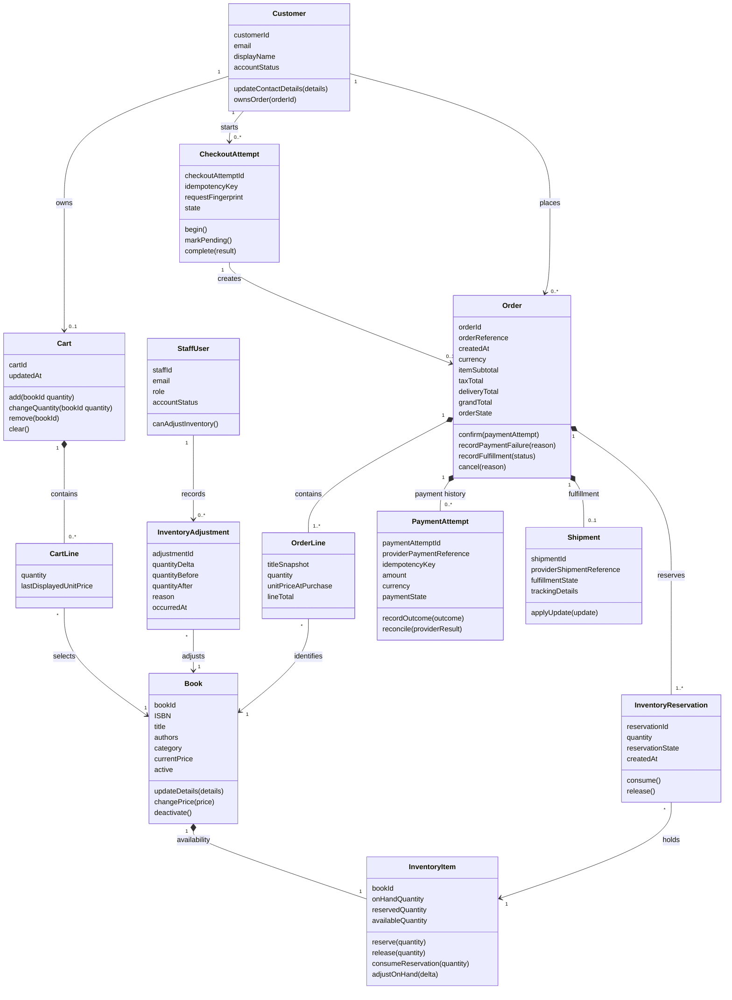

# Online Bookstore Data Model

The model is technology-neutral. Fields list business data and identifiers;
storage representation is chosen during implementation. Secrets and raw
payment credentials are explicitly excluded.

## Entities and Value Objects

### Customer

- **Fields**: `customerId`, `email`, `displayName`, `contactDetails`,
  `createdAt`, `accountStatus`
- **Rules**: email is required and unique; only an active authenticated
  customer may access their account, cart, and orders.
- **Operations**: `updateContactDetails(details)`,
  `ownsOrder(orderId)`.

### StaffUser

- **Fields**: `staffId`, `email`, `displayName`, `role`, `accountStatus`
- **Rules**: only an active staff account with the required role may maintain
  catalog, inventory, or fulfillment state.
- **Operations**: `canManageCatalog()`, `canAdjustInventory()`,
  `canManageFulfillment()`.

### Book

- **Fields**: `bookId`, `ISBN?`, `title`, `authors`, `description`,
  `category`, `currentPrice`, `active`
- **Rules**: title and price are required; price is nonnegative; inactive books
  cannot be newly added or purchased. A cart does not guarantee its saved price
  or availability at checkout.
- **Operations**: `updateDetails(details)`, `changePrice(price)`,
  `activate()`, `deactivate()`.

### InventoryItem

- **Fields**: `bookId`, `onHandQuantity`, `reservedQuantity`, `version`
- **Derived field**: `availableQuantity = onHandQuantity - reservedQuantity`
- **Rules**: quantities are nonnegative; reserved quantity cannot exceed
  on-hand quantity; changes that could conflict with concurrent reservations
  are atomic.
- **Operations**: `reserve(quantity)`, `release(quantity)`,
  `consumeReservation(quantity)`, `adjustOnHand(delta)`.

### InventoryAdjustment

- **Fields**: `adjustmentId`, `bookId`, `staffId`, `quantityDelta`,
  `quantityBefore`, `quantityAfter`, `reason`, `occurredAt`
- **Rules**: records every staff-initiated stock change; adjustment is rejected
  if the resulting on-hand quantity is negative or below reserved quantity.

### Cart and CartLine

- **Cart fields**: `cartId`, `customerId`, `updatedAt`
- **CartLine fields**: `bookId`, `quantity`, `lastDisplayedUnitPrice`
- **Rules**: a customer's active cart contains at most one line per book;
  quantity must be a positive whole number. Displayed price is informational,
  not the authoritative purchase price.
- **Operations**: `add(bookId, quantity)`, `changeQuantity(bookId, quantity)`,
  `remove(bookId)`, `clear()`.

### CheckoutAttempt

- **Fields**: `checkoutAttemptId`, `customerId`, `idempotencyKey`,
  `requestFingerprint`, `createdAt`, `updatedAt`, `state`
- **Rules**: `idempotencyKey` is unique within the customer scope; reusing the
  key with the same request returns the existing attempt, while reusing it for
  a different request is rejected. A retry after a completed decline is a new
  attempt with a new key.
- **Operations**: `begin()`, `markPending()`, `complete(result)`.

### Order and OrderLine

- **Order fields**: `orderId`, `orderReference`, `customerId`,
  `checkoutAttemptId`, `createdAt`, `currency`, `itemSubtotal`,
  `taxTotal`, `deliveryTotal`, `grandTotal`, `deliveryAddressSnapshot`,
  `orderState`
- **Order states**: `PendingPayment`, `Confirmed`, `PaymentFailed`,
  `FulfillmentInProgress`, `Shipped`, `Delivered`, `Cancelled`
- **OrderLine fields**: `bookId`, `titleSnapshot`, `quantity`,
  `unitPriceAtPurchase`, `lineTotal`
- **Rules**: an order has one or more immutable purchase lines and a unique
  reference. `PendingPayment` is not shown as confirmed. Only approved payment
  can transition the order to `Confirmed`; a decline cannot. A customer may
  read only orders associated with their authenticated `customerId`.
- **Operations**: `confirm(paymentAttempt)`,
  `recordPaymentFailure(reason)`, `recordFulfillment(status)`,
  `cancel(reason)`.

### PaymentAttempt

- **Fields**: `paymentAttemptId`, `orderId`, `providerId`,
  `providerPaymentReference?`, `idempotencyKey`, `amount`, `currency`,
  `paymentState`, `requestedAt`, `resolvedAt?`
- **Payment states**: `Pending`, `Approved`, `Declined`, `Unknown`,
  `Voided`
- **Rules**: amount and currency match the order total; credentials are
  tokenized/provider-managed, never stored as raw card or bank details.
  `Unknown` or `Pending` is not a decline and cannot confirm the order.
- **Operations**: `recordOutcome(outcome)`, `reconcile(providerResult)`,
  `voidIfSupported()`.

### InventoryReservation

- **Fields**: `reservationId`, `orderId`, `bookId`, `quantity`,
  `reservationState`, `createdAt`, `resolvedAt?`
- **Reservation states**: `Active`, `Consumed`, `Released`
- **Rules**: active reservation quantity is included in inventory's reserved
  quantity; a reservation is consumed once after payment approval or released
  once after a verified non-payment outcome. An unresolved payment must not
  release stock merely because a local request timed out.
- **Operations**: `consume()`, `release()`.

### Shipment

- **Fields**: `shipmentId`, `orderId`, `providerShipmentReference?`,
  `fulfillmentState`, `trackingDetails?`, `lastUpdatedAt`
- **Fulfillment states**: `NotSubmitted`, `Submitted`, `Processing`,
  `Shipped`, `Delivered`, `Exception`
- **Rules**: shipment belongs to one order; no shipment is implied until
  fulfillment details are accepted. Provider updates are correlated to the
  correct shipment and duplicate updates do not duplicate state changes.
- **Operations**: `submit()`, `applyUpdate(update)`.

## Relationships (UML Class Diagram)



## State Transitions

### Order

```text
PendingPayment -> Confirmed -> FulfillmentInProgress -> Shipped -> Delivered
PendingPayment -> PaymentFailed
PendingPayment -> Cancelled (only after payment is known not to be captured)
Confirmed -> Cancelled (only if the business cancellation policy allows it)
```

An order cannot transition from `PaymentFailed` to `Confirmed`; another
purchase attempt creates a new checkout attempt/order. Provider reconciliation
of an unknown payment updates the original attempt and order rather than
creating a second order.

### Reservation

```text
Active -> Consumed
Active -> Released
```

Only one terminal transition may succeed. Consuming decrements both on-hand and
reserved quantities; releasing decrements reserved quantity only.

### PaymentAttempt

```text
Pending -> Approved
Pending -> Declined
Pending -> Unknown -> Approved | Declined | Voided
Approved -> Voided (only when supported and confirmed by provider)
```

`Pending` and `Unknown` require reconciliation, not a new unkeyed charge.

## Requirement Traceability

- Catalog and cart: FR-001–FR-005, FR-014.
- Checkout, price/stock validation, payment, and duplicate protection:
  FR-007–FR-011, FR-017–FR-019.
- Account ownership and order visibility: FR-006, FR-012–FR-013.
- Staff fulfillment and shipment status: FR-015–FR-016.
