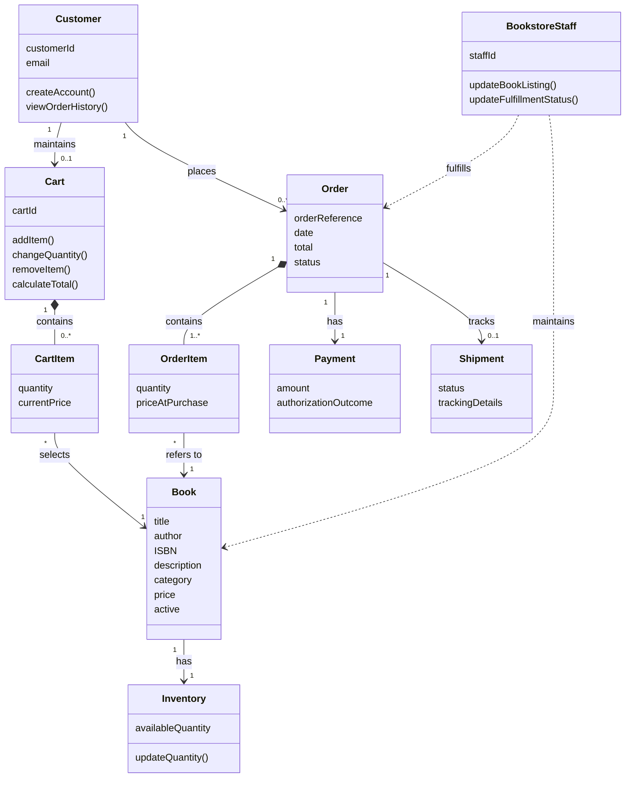
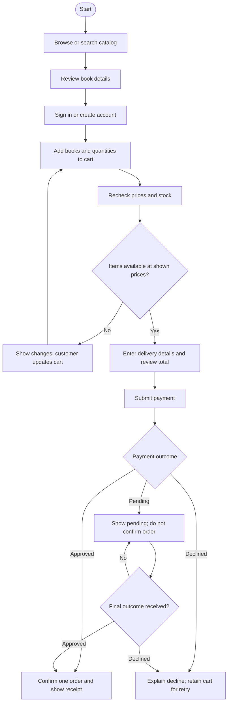
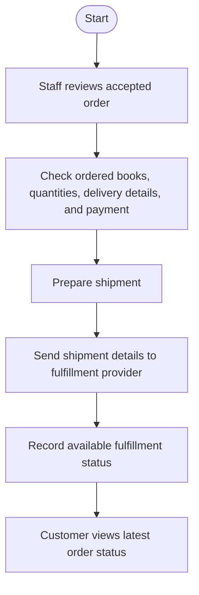

# Feature Specification: Online Bookstore

**Feature Branch**: `001-online-bookstore`

**Created**: 2026-11-05

**Status**: Draft

**Input**: User description: "Create a baseline specification for Online Bookstore. Include core functional requirements, system actors, key domain entities, and user workflows."

## User Scenarios & Testing *(mandatory)*

### System Actors

- **Visitor**: Browses and searches the public book catalog.
- **Customer**: Creates or uses an account to maintain a cart, place orders, and
  view order history and status.
- **Bookstore staff**: Maintains book listings and stock, and updates order
  progress for fulfillment.
- **Payment provider**: An external party that authorizes or declines payment.
- **Fulfillment provider**: An external party that receives shipment details
  and provides shipment progress when available.

### User Story 1 - Find and Purchase Books (Priority: P1)

A visitor finds books in the catalog and reviews book details. To purchase,
the customer signs in or creates an account, adds desired quantities to a cart,
reviews the final order total, supplies delivery and payment information, and
places the order. The customer receives confirmation when payment is accepted.

**Why this priority**: Finding and purchasing books is the bookstore's primary
customer journey and delivers its core business value.

**Independent Test**: Using an in-stock book and a successful payment outcome,
verify a customer can find the book, add it to a cart, place one order, and
receive confirmation.

**Acceptance Scenarios**:

1. **Given** an active book listing, **When** a visitor searches by title,
   author, or ISBN, or filters by category or availability, **Then** only
   matching listings are shown with price and availability.
2. **Given** a visitor viewing a listing, **When** they open a book's details,
   **Then** the available description, ISBN, price, and stock availability are
   displayed.
3. **Given** a book in stock, **When** a customer adds a valid quantity to the
   cart, **Then** the cart shows the book, quantity, current item price, and
   updated subtotal and total.
4. **Given** a cart with multiple items, **When** a customer changes a
   quantity or removes an item, **Then** the cart contents and totals are
   recalculated.
5. **Given** a cart with available books, **When** a customer reviews checkout,
   **Then** the delivery details and complete order total are shown before
   payment is submitted; applicable taxes and delivery charges are included.
6. **Given** a cart item whose price or availability changed, **When** the
   customer proceeds to checkout, **Then** the updated price or availability
   is shown and an unavailable or excessive quantity cannot be ordered.
7. **Given** valid checkout details and an approved payment, **When** the
   customer places the order, **Then** exactly one order is recorded and the
   customer receives its reference and summary.
8. **Given** a payment is declined, **When** the customer attempts checkout,
   **Then** no order is confirmed, the customer is told payment was not
   accepted, and the cart remains available for correction or retry.
9. **Given** a customer repeats the same checkout submission, **When** the
   payment is accepted, **Then** only one confirmed order exists for that
   checkout.
10. **Given** the payment provider has not returned a final outcome, **When**
    the customer checks the order, **Then** payment is shown as pending and no
    order is shown as confirmed until the outcome is known.

---

### User Story 2 - Manage Account and Orders (Priority: P2)

A customer creates an account, signs in, and reviews past purchases and their
current fulfillment status.

**Why this priority**: Account and order access let customers return to the
store and independently check the outcome of purchases.

**Independent Test**: Create a customer account, place a test order, sign in
again, and verify that the order and its latest status appear only to that
customer.

**Acceptance Scenarios**:

1. **Given** a new customer with valid account details, **When** they create an
   account and sign in, **Then** the account is available for order placement.
2. **Given** a signed-in customer with a completed purchase, **When** they open
   order history, **Then** they see that order's reference, date, total, and
   latest status.
3. **Given** an order belonging to another customer, **When** a customer views
   their order history, **Then** the other customer's order details are not
   disclosed.

---

### User Story 3 - Maintain Catalog and Fulfill Orders (Priority: P3)

Bookstore staff maintains book details and stock, then reviews new orders and
updates their fulfillment progress. Customers can see the published catalog
and the latest order status.

**Why this priority**: Staff operations keep the catalog accurate and enable
the bookstore to fulfill the orders created by the primary journey.

**Independent Test**: As staff, publish a book with available stock, verify it
can be found by a visitor, then update a test order's status and verify the
customer sees that status.

**Acceptance Scenarios**:

1. **Given** an authorized staff member, **When** they publish, update, or
   deactivate a book listing and update its stock, **Then** the public catalog
   reflects the active listing and current availability, or no longer shows a
   deactivated listing.
2. **Given** a newly accepted order, **When** staff records fulfillment
   progress, **Then** the order status is updated and visible to its customer.
3. **Given** a staff member reviewing orders, **When** they open an order,
   **Then** they see its items, quantities, delivery details, and payment
   outcome needed to fulfill it.
4. **Given** no shipment update is available, **When** a customer checks the
   order, **Then** the system distinguishes the pending update from a reported
   shipment status.

### Edge Cases

- A search has no matches, or the catalog has no active listings.
- A customer requests a quantity greater than current available stock.
- A book's stock or price changes after it is added to a cart but before
  checkout.
- Payment is declined, times out, or returns an indeterminate outcome.
- A customer submits the same checkout more than once.
- A customer attempts to access another customer's order.
- A listing is deactivated while it remains in a customer's cart.
- An external fulfillment provider has not supplied a shipment update yet.

## Requirements *(mandatory)*

### Functional Requirements

- **FR-001**: The system MUST allow visitors to browse active book listings
  showing title, author, price, and availability.
- **FR-002**: The system MUST allow visitors to search by title, author, or
  ISBN and filter results by category and availability.
- **FR-003**: The system MUST show a book's available descriptive details,
  including its title, author, ISBN when available, description, price, and
  stock availability.
- **FR-004**: The system MUST allow customers to add books to a cart, change
  quantities, and remove items before order placement.
- **FR-005**: The system MUST show each cart item's current price, quantity,
  subtotal, and the cart total.
- **FR-006**: The system MUST allow a visitor to create an account and a
  customer to sign in before placing an order.
- **FR-007**: Before accepting an order, the system MUST recheck that each
  requested book is active and has sufficient available stock, and show any
  price or availability changes to the customer.
- **FR-008**: The system MUST collect the customer's delivery details and
  present item costs, applicable delivery charges, applicable taxes, and the
  complete total before payment.
- **FR-009**: The system MUST submit payment for authorization through the
  supported payment provider and clearly report whether payment was accepted
  or declined.
- **FR-010**: The system MUST create one confirmed order for an accepted
  payment and MUST NOT confirm an order for a declined payment.
- **FR-011**: On successful order placement, the system MUST show the customer
  an order reference, ordered items, total, and initial status.
- **FR-012**: The system MUST let a signed-in customer view their own order
  history, including each order's reference, date, total, and latest status.
- **FR-013**: The system MUST prevent customers from viewing another
  customer's account or order details.
- **FR-014**: The system MUST let authorized bookstore staff create, update,
  and deactivate book listings and update stock quantities.
- **FR-015**: The system MUST let authorized bookstore staff review order
  details and record fulfillment status changes.
- **FR-016**: The system MUST display the latest available fulfillment status
  to the customer and distinguish an order with no shipment update from one
  with a reported update.
- **FR-017**: The system MUST retain the cart after an unsuccessful payment
  attempt so the customer can retry or change the order.
- **FR-018**: The system MUST not create multiple confirmed orders when the
  customer repeats a submission for the same checkout attempt.
- **FR-019**: If the payment outcome is indeterminate, the system MUST tell the
  customer that payment is pending and MUST NOT show the order as confirmed
  until the outcome is known.

### Key Entities

- **Customer**: A person with an account, sign-in details, and contact
  information; owns carts and orders.
- **Book**: A catalog listing with title, author, ISBN when available,
  description, category, price, and active status.
- **Inventory**: The current available quantity for a book.
- **Cart**: A customer's pending selection of books and quantities before
  order placement.
- **Cart item**: A selected book, quantity, and current price within a cart.
- **Order**: A customer's submitted purchase, with a unique reference, date,
  total, delivery details, payment outcome, and fulfillment status.
- **Order item**: A book and purchased quantity with the price charged at
  purchase time; belongs to one order.
- **Payment**: The authorization outcome and amount associated with an order.
- **Shipment**: Fulfillment progress and any available tracking details
  associated with an order.

### Domain Relationships (UML Class Diagram)

### Customer Purchase Workflow

### Staff Order Fulfillment Workflow

## Success Criteria *(mandatory)*

### Measurable Outcomes

- **SC-001**: At least 90% of representative test users find a specified
  in-stock book and add it to their cart within two minutes.
- **SC-002**: At least 95% of representative test users complete a valid
  purchase in under five minutes, excluding time spent waiting for an external
  payment decision.
- **SC-003**: In all payment outcome tests, an accepted payment results in
  exactly one confirmed order, and a declined payment results in no confirmed
  order.
- **SC-004**: At least 95% of customers in usability tests locate the latest
  status of their own order within one minute.
- **SC-005**: In access-control tests, zero customers can view another
  customer's order details.

## Assumptions

- The initial release is a single bookstore serving customers in supported
  delivery regions.
- Customers must create or use an account to place an order; browsing does not
  require an account.
- The bookstore defines which payment methods, delivery regions, taxes, and
  delivery charges are supported; checkout displays applicable amounts before
  the customer submits payment.
- The payment provider returns an authorization outcome. Orders are considered
  confirmed only after payment is accepted.
- Staff accounts are authorized by the bookstore; public customers cannot
  perform catalog or fulfillment operations.
- Fulfillment status is shown when supplied by staff or the fulfillment
  provider. Returns, refunds, promotions, reviews, and digital-book delivery
  are outside this baseline specification.
